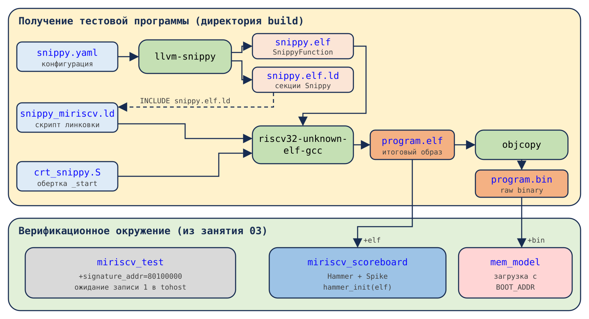
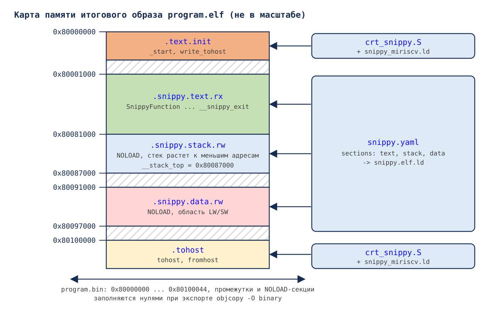

# Практическое занятие 04: Синхронное сравнение с эталонной моделью. Генератор llvm-snippy

- [Практическое занятие 04: Синхронное сравнение с эталонной моделью. Генератор llvm-snippy](#практическое-занятие-04-синхронное-сравнение-с-эталонной-моделью-генератор-llvm-snippy)
  - [Необходимое ПО](#необходимое-по)
  - [Рекомендуемый материал](#рекомендуемый-материал)
  - [Краткое содержание](#краткое-содержание)
  - [Важные сведения](#важные-сведения)
  - [Тестируемое RISC-V ядро](#тестируемое-risc-v-ядро)
  - [Используемая эталонная модель Spike и библиотека Hammer](#используемая-эталонная-модель-spike-и-библиотека-hammer)
  - [Используемый генератор случайных инструкций llvm-snippy](#используемый-генератор-случайных-инструкций-llvm-snippy)
  - [Смотрим в будущее](#смотрим-в-будущее)
  - [Структура верификационного окружения](#структура-верификационного-окружения)
  - [Установка llvm-snippy](#установка-llvm-snippy)
  - [Подготовка](#подготовка)
  - [Работа с генератором случайных RISC-V инструкций llvm-snippy](#работа-с-генератором-случайных-risc-v-инструкций-llvm-snippy)
    - [Создание файла конфигурации `snippy.yaml`](#создание-файла-конфигурации-snippyyaml)
    - [Пробная генерация тестовой программы](#пробная-генерация-тестовой-программы)
    - [Карта памяти тестовой программы](#карта-памяти-тестовой-программы)
    - [Создание ассемблерной обертки `crt_snippy.S`](#создание-ассемблерной-обертки-crt_snippys)
    - [Создание скрипта линковки `snippy_miriscv.ld`](#создание-скрипта-линковки-snippy_miriscvld)
  - [Сборка и запуск симуляции](#сборка-и-запуск-симуляции)
    - [Компиляция библиотеки `Hammer`](#компиляция-библиотеки-hammer)
    - [Генерация тестовой программы](#генерация-тестовой-программы)
    - [Линковка тестовой программы](#линковка-тестовой-программы)
    - [Анализ тестовой программы](#анализ-тестовой-программы)
    - [Экспорт тестовой программы](#экспорт-тестовой-программы)
    - [Запуск симуляции](#запуск-симуляции)
  - [Анализ результатов](#анализ-результатов)
    - [Лог-файлы](#лог-файлы)
    - [Осознанное внедрение ошибок](#осознанное-внедрение-ошибок)
      - [Модификация RTL MIRISCV](#модификация-rtl-miriscv)
      - [Повторный запуск](#повторный-запуск)
      - [Анализ лог-файлов](#анализ-лог-файлов)
    - [Воспроизведение тестовой программы](#воспроизведение-тестовой-программы)
  - [Эталонная реализация](#эталонная-реализация)
  - [Выводы](#выводы)


## Необходимое ПО

Подразумевается, что **задание выполняется на:**
- [предоставленной виртуальной машине](../../#использование-виртуальной-машины);
- ином дистрибутиве Linux с [установленным необходимым ПО](../../#ручная-установка).

**Обратите внимание**, что генератор [llvm-snippy](#используемый-генератор-случайных-инструкций-llvm-snippy) в предоставленную виртуальную машину не входит. Его установка описана в разделе [Установка llvm-snippy](#установка-llvm-snippy) и занимает пару минут.


## Рекомендуемый материал

- [Тема 00: Вводная](../../theory/00_intro.md)
- [Тема 01: Функциональная верификация процессорных ядер](../../theory/01_basics.md)
- [Тема 02: Основные подходы к функциональной верификации RISC-V ядер](../../theory/02_approach.md)
- [Тема 03: Базовые подходы к симуляции RISC-V ядер](../../theory/03_func.md)
- [Тема 04: RISC-V верификация: сравнение с эталонной моделью](../../theory/04_rgen.md)
- [Тема 05: RISC-V верификация: модифицированное сравнение с эталонной моделью](../../theory/05_advanced.md)


## Краткое содержание

Данное занятие воспроизводит маршрут подхода к верификации процессорных ядер [при помощи синхронного сравнения с эталонной моделью](../../theory/05_advanced.md#синхронное-сравнение) на примере RISC-V ядра с открытым исходным кодом [MIRISCV](https://github.com/riscv-tests-intro/MIRISCV/tree/b510b308addc4a7271e36f2a348bd18bf24c1d77). Занятие является **надстройкой** над занятием [Практическое занятие 03: Синхронное сравнение с эталонной моделью](../03_hammer). Его выполнение обязательно для того, чтобы приступить к данному занятию.

Верификационное окружение, библиотека [Hammer](https://github.com/rivosinc/hammer/tree/6d9fac96407149a1a533cdd3f63f6bbd96614ffa) и подход к сравнению остаются **без изменений**. Заменяется только генератор случайных инструкций: вместо [AAPG](https://gitlab.com/shaktiproject/tools/aapg/-/tree/7ce4a9073a040bbc784edfd1c8a7b21f269f7766) используется [llvm-snippy](https://github.com/syntacore/snippy/tree/snippy-3.0).

Текущее занятие будет состоять из **4 основных этапов, выполняемых друг за другом:**
- [Установка llvm-snippy](#установка-llvm-snippy) – скачивается и устанавливается собранная версия генератора;
- [Работа с генератором случайных RISC-V инструкций llvm-snippy](#работа-с-генератором-случайных-risc-v-инструкций-llvm-snippy) – создается файл конфигурации генератора, разбирается результат его работы, создаются ассемблерная обертка и скрипт линковки[^1], которые превращают сгенерированную функцию в полноценную тестовую программу для MIRISCV;
- [Сборка и запуск симуляции](#сборка-и-запуск-симуляции) – генерируется, линкуется и экспортируется случайная тестовая программа, после чего запускается симуляция с синхронным сравнением;
- [Анализ результатов](#анализ-результатов) – производится сравнение поведения процессора и модели, делается вывод о корректности его работы.


## Важные сведения

**Обратите внимание**, что в части файлов, которые разбираются в ходе занятия, часть кода осознанно пропущена, оставлена лишь значимая, необходимая для формирования общей картины.

Например:

```assembly
80001000 <SnippyFunction>:
80001000:	800875b7          	lui	a1,0x80087
80001004:	ff058593          	addi	a1,a1,-16
...
8000293c <__snippy_exit>:
8000293c:	00008067          	ret
```

В данном фрагменте пропущена часть инструкций между `addi a1,a1,-16` и меткой `__snippy_exit`.

**Обратите внимание**, что тестовая программа генерируется случайно. Адреса, регистры и инструкции в ваших файлах будут отличаться от приведенных в описании. Для получения точно такой же программы, как в описании, используйте `--seed=1` (подробнее в разделе [Воспроизведение тестовой программы](#воспроизведение-тестовой-программы)).


## Тестируемое RISC-V ядро

В рамках курса будет тестироваться учебное ядро, разработанное [НИЛ ЭСК](https://miet.ru/structure/s/3812) НИУ МИЭТ: [MIRISCV](https://github.com/riscv-tests-intro/MIRISCV/tree/b510b308addc4a7271e36f2a348bd18bf24c1d77). Процессор поддерживает расширения RV32I и RV32M и является четырехстадийным [in-order](https://en.wikipedia.org/wiki/Out-of-order_execution#In-order_processors) [конвейером](https://en.wikipedia.org/wiki/Instruction_pipelining). Ядро поддерживает только машинный уровень привилегий[^2].

<p align="center">
  </img>
</p>

Подробную документацию на процессор можно найти по [ссылке](https://github.com/riscv-tests-intro/MIRISCV/tree/b510b308addc4a7271e36f2a348bd18bf24c1d77/doc/miriscv/miriscv_scheme.md). В рамках курса его функциональные особенности подробно разбираться не будут, а необходимая для выполнения заданий информация будет даваться по ходу повествования.


## Используемая эталонная модель [Spike](https://github.com/riscv-software-src/riscv-isa-sim/tree/887d02e42124ddc86476dfdf4aad4be8ba7f0aef) и библиотека [Hammer](https://github.com/rivosinc/hammer/tree/6d9fac96407149a1a533cdd3f63f6bbd96614ffa)

Используются эталонная модель Spike и библиотека для взаимодействия с ней Hammer такие же, как в [предыдущем занятии](../03_hammer). Для получения подробной информации раскройте спойлер ниже.

<details>
  <summary>Подробно про Spike и Hammer</summary>

---

Для тестирования процессорного ядра будет использоваться эталонная модель [Spike](https://github.com/riscv-software-src/riscv-isa-sim/tree/887d02e42124ddc86476dfdf4aad4be8ba7f0aef), написанная на языке C. В настоящее время эта модель является самой популярной открытой моделью.

Для запуска Spike непосредственно в ходе RTL-симуляции используется библиотека [Hammer](https://github.com/rivosinc/hammer/tree/6d9fac96407149a1a533cdd3f63f6bbd96614ffa), разработанная компанией [Rivos Inc.](https://www.rivosinc.com/). Методы библиотеки вызываются из верификационного окружения при помощи DPI-C[^3]. Анализ библиотеки, ее модификация и определение API для взаимодействия с ней подробно разобраны в разделах [Анализ библиотеки для взаимодействия со Spike `Hammer`](../03_hammer/README.md#анализ-библиотеки-для-взаимодействия-со-spike-hammer) и [Определение API для взаимодействия со Spike при помощи библиотеки `Hammer` через DPI-C](../03_hammer/README.md#определение-api-для-взаимодействия-со-spike-при-помощи-библиотеки-hammer-через-dpi-c) предыдущего занятия.

---

</details>


## Используемый генератор случайных инструкций [llvm-snippy](https://github.com/syntacore/snippy/tree/snippy-3.0)

Для создания тестовой программы будет использоваться генератор случайных инструкций [llvm-snippy](https://github.com/syntacore/snippy/tree/snippy-3.0), разработанный компанией [Syntacore](https://syntacore.com/). Генератор написан на языке C++ и построен на основе инфраструктуры компилятора [LLVM](https://llvm.org/). Благодаря этому llvm-snippy "знает" все инструкции, которые поддерживает LLVM для архитектуры RISC-V, и сам кодирует их в машинный код без внешнего ассемблера. Документация на генератор доступна по [ссылке](https://syntacore.github.io/snippy/).

На момент создания данного практического занятия последней версией генератора является [snippy-3.0](https://github.com/syntacore/snippy/releases/tag/snippy-3.0), выпущенная в июне 2026 года. В рамках занятия используется именно она.

Почему бы не остаться на [AAPG](https://gitlab.com/shaktiproject/tools/aapg/-/tree/7ce4a9073a040bbc784edfd1c8a7b21f269f7766)? Генераторы устроены по-разному, и знакомство с несколькими подходами к генерации полезно само по себе. Основные отличия представлены в таблице ниже.

| Характеристика | AAPG | llvm-snippy |
| --- | --- | --- |
| Язык реализации | Python | C++ (LLVM) |
| Результат генерации | Ассемблерный файл, `crt.S`, скрипт линковки и `Makefile` для сборки программы | Готовый объектный `elf`-файл[^4] с функцией `SnippyFunction` и скрипт линковки для ее секций |
| Старт и завершение программы | Генерируются автоматически (`_start`, запись в `tohost`) | Отсутствуют, нужна пользовательская обертка |
| Распределение инструкций | По группам (`rel_rv32i.compute`, `rel_rv32m` и т.д.) | По конкретным инструкциям (`ADD`, `SLLI` и т.д.) |
| Инициализация регистров | Загрузка из памяти в `crt.S` | Инструкции `lui`/`addi` в начале функции (опция `init-regs-in-elf`) |
| CSR-инструкции в программе | Есть (обработчики исключений), требуется `Zicsr` для компиляции | Нет |
| Эталонная модель в контуре генерации | Нет | Опционально (Spike, Whisper) |

Самое важное для нас отличие – **llvm-snippy генерирует не программу, а функцию**. Ее нужно вызвать из пользовательского кода, который подготовит стек, а после возврата из функции сообщит верификационному окружению о завершении теста. Этим мы и займемся в ходе занятия.


## Смотрим в будущее

В [предыдущем занятии](../03_hammer) было разработано [верификационное окружение](../03_hammer/README.md#структура-верификационного-окружения) для реализации [синхронного сравнения с эталонной моделью](../../theory/05_advanced.md#синхронное-сравнение). Окружение получает тестовую программу двумя способами:
- через аргумент `+bin` – бинарный файл, который загружается в модель памяти, начиная с адреса `BOOT_ADDR` (`0x80000000`);
- через аргумент `+elf` – исполняемый файл, который загружается в Spike при помощи библиотеки `Hammer`.

Также окружение ожидает, что программа:
- начинается по адресу `0x80000000`, так как именно с него начинают выполнение и MIRISCV, и Spike;
- завершается записью значения `1` по адресу `signature_addr` (`0x80100000`);
- не содержит CSR-инструкций, так как MIRISCV не поддерживает расширение `Zicsr`.

[AAPG](https://gitlab.com/shaktiproject/tools/aapg/-/tree/7ce4a9073a040bbc784edfd1c8a7b21f269f7766) выполнял эти требования самостоятельно (см. раздел [Генерация тестовой программы](../03_hammer/README.md#генерация-тестовой-программы) предыдущего занятия). В случае llvm-snippy за их выполнение отвечаем мы. На основании информации выше сформируем список задач:
- [установка llvm-snippy](#установка-llvm-snippy);
- [создание файла конфигурации `snippy.yaml`](#создание-файла-конфигурации-snippyyaml) с картой памяти и распределением инструкций для MIRISCV;
- [создание ассемблерной обертки `crt_snippy.S`](#создание-ассемблерной-обертки-crt_snippys), которая вызывает сгенерированную функцию и сообщает о завершении теста;
- [создание скрипта линковки `snippy_miriscv.ld`](#создание-скрипта-линковки-snippy_miriscvld), который размещает обертку и секции генератора по нужным адресам;
- [сборка и запуск симуляции](#сборка-и-запуск-симуляции) с новой тестовой программой.

Выполнение данных задач будет рассмотрено в разделах ниже.


## Структура верификационного окружения

Верификационное окружение данного практического занятия **полностью совпадает** с окружением предыдущего занятия [Практическое занятие 03: Синхронное сравнение с эталонной моделью](../03_hammer). Структура представлена на изображении ниже:

<p align="center">
  </img>
</p>

Подробное описание компонентов окружения приведено в разделе [Структура верификационного окружения](../03_hammer/README.md#структура-верификационного-окружения) предыдущего занятия.

Изменяется лишь маршрут получения тестовой программы. Он представлен на изображении ниже:

<p align="center">
  </img>
</p>

Генератор llvm-snippy на основе файла конфигурации `snippy.yaml` создает объектный файл `snippy.elf` с функцией `SnippyFunction`, а также скрипт линковки `snippy.elf.ld` с описанием своих секций. Далее при помощи компилятора `riscv32-unknown-elf-gcc` ассемблерная обертка `crt_snippy.S` и `snippy.elf` линкуются в итоговый исполняемый файл `program.elf`. Расположение секций определяет скрипт линковки `snippy_miriscv.ld`, который подключает скрипт `snippy.elf.ld` при помощи директивы `INCLUDE`. Исполняемый файл `program.elf` передается в Spike через `Hammer`, а полученный из него при помощи `objcopy` бинарный файл `program.bin` загружается в модель памяти окружения.


## Установка llvm-snippy

Компания Syntacore публикует собранные версии генератора для Linux в [разделе релизов](https://github.com/syntacore/snippy/releases/tag/snippy-3.0) репозитория. Для релиза snippy-3.0 доступны две сборки: `snippy-x86_64-linux-ubuntu.tar.xz` и `snippy-x86_64-linux-rocky.tar.xz`.

**Обратите внимание**, что сборка `ubuntu` требует библиотеку `glibc` версии не ниже 2.38 и **не запускается** на Ubuntu 22.04 (в ней `glibc` 2.35). Сборка `rocky` на Ubuntu 22.04 работает корректно, поэтому будем использовать ее.

Определяем директорию установки (такую же, как в [инструкции по ручной установке ПО](../../doc/soft.md#общие-зависимости)):

```bash
export INSTALL_DIR=~/usr/bin
```

Скачиваем архив:

```bash
wget https://github.com/syntacore/snippy/releases/download/snippy-3.0/snippy-x86_64-linux-rocky.tar.xz
```

Распаковываем:

```bash
sudo mkdir -p $INSTALL_DIR/snippy
sudo tar -xJf snippy-x86_64-linux-rocky.tar.xz -C $INSTALL_DIR/snippy
rm snippy-x86_64-linux-rocky.tar.xz
```

Добавляем в PATH для всех пользователей:

```bash
echo "PATH=$INSTALL_DIR/snippy/bin"':$PATH' | sudo tee -a /etc/profile
source /etc/profile
```

**или** текущего:

```bash
echo "PATH=$INSTALL_DIR/snippy/bin"':$PATH' >> ~/.profile
source ~/.profile
```

Проверим установку:

```bash
llvm-snippy --version
```

Увидим что-то похожее на:

```bash
LLVM (http://llvm.org/):
  LLVM version 21.1.8
  Optimized build with assertions.
Snippy version: 3.0.0
```

Помимо исполняемого файла `llvm-snippy`, архив содержит примеры файлов конфигурации в директории `$INSTALL_DIR/snippy/share/examples` и страницу руководства `man`. Если интересно, загляните в них.

Эта же инструкция продублирована в [инструкции по ручной установке ПО](../../doc/soft.md#генератор-случайных-инструкций-risc-v-llvm-snippy-30).


## Подготовка

**Подразумевается, что команды начинают выполняться в директории, в которой расположен данный файл с описанием занятия.** Нам понадобятся две директории:

- `tb` – для исходных файлов верификационного окружения;
- `build` – для файлов сборки и запуска тестирования.

**Директорию `tb` вместе со всем ее содержимым скопируем из эталонной реализации предыдущего занятия:**

```bash
cp -r ../03_hammer/golden/tb ./
```

**Обратите внимание**, что в ходе текущего занятия файлы в директории `tb` модифицироваться **не будут**. Это и есть главная идея занятия: верификационное окружение остается прежним, меняется только источник тестовой программы.

Создадим директорию `build`:

```bash
mkdir build
```

Скопируем в нее файл с реализацией DPI-C методов для вызова библиотеки `Hammer`, разработанный в разделе [Определение API со стороны C++](../03_hammer/README.md#определение-api-со-стороны-c) предыдущего занятия:

```bash
cp ../03_hammer/golden/build/hammer_dpi.cpp build/
```


## Работа с генератором случайных RISC-V инструкций [llvm-snippy](https://github.com/syntacore/snippy/tree/snippy-3.0)

Перейдем в директорию для сборки и запуска:

```bash
cd build
```

### Создание файла конфигурации `snippy.yaml`

llvm-snippy, как и AAPG, настраивается при помощи файла конфигурации в формате [YAML](https://en.wikipedia.org/wiki/YAML). Файл состоит из нескольких разделов, нам понадобятся три из них: `sections`, `options` и `histogram`.

Создадим необходимый файл:

```bash
touch snippy.yaml
```

Файл можно открыть в любом редакторе. Открываем при помощи gedit:

```bash
gedit snippy.yaml
```

Заполним файл следующим кодом:

```yaml
sections:
  - name:   text
    VMA:    0x80001000
    LMA:    0x80001000
    SIZE:   0x00080000
    ACCESS: rx

  - name:   stack
    VMA:    0x80081000
    LMA:    0x80081000
    SIZE:   0x00006000
    ACCESS: rw

  - name:   data
    VMA:    0x80091000
    LMA:    0x80091000
    SIZE:   0x00006000
    ACCESS: rw
```

Раздел `sections` описывает области памяти, с которыми может работать сгенерированная программа. Для каждой области задается имя `name`, адрес размещения `VMA` (Virtual Memory Address) и загрузки `LMA` (Load Memory Address), размер `SIZE` и права доступа `ACCESS`:
- `text` с правами `rx` (чтение и исполнение) – сюда генератор поместит инструкции;
- `stack` с правами `rw` – стек, используется для сохранения регистров (см. ниже опцию `honor-target-abi`). Имя `stack` зарезервировано, генератор распознает стек именно по нему;
- `data` с правами `rw` – данные, по адресам из этой области будут обращаться инструкции `lw` и `sw`.

Почему адреса именно такие, разберемся в разделе [Карта памяти тестовой программы](#карта-памяти-тестовой-программы). Пока лишь отметим, что область данных `0x80091000` – `0x80097000` выбрана той же, что и в конфигурации AAPG (см. раздел `access-sections` в [файле конфигурации](../03_hammer/golden/build/config.yaml) предыдущего занятия).

Дополним файл следующим кодом:

```yaml
options:
  mtriple: riscv32
  march: rv32im
  model-plugin: None

  entry-point: SnippyFunction
  last-instr: RET

  honor-target-abi: true
  init-regs-in-elf: true
```

Раздел `options` содержит опции генератора. Любую из них также можно передать через командную строку, например `--march=rv32im`. Разберем опции:
- `mtriple: riscv32` и `march: rv32im` – целевая архитектура: 32-битный RISC-V с расширениями RV32I и RV32M, как у MIRISCV;
- `model-plugin: None` – генератор не будет исполнять программу на эталонной модели в процессе генерации. Сравнение с моделью у нас и так производится в ходе RTL-симуляции;
- `entry-point: SnippyFunction` – имя генерируемой функции. Именно его будет вызывать наша обертка;
- `last-instr: RET` – последняя инструкция функции. По умолчанию генератор завершает программу инструкцией `ebreak`, которая вызвала бы исключение. Нам же нужно, чтобы управление вернулось в обертку;
- `honor-target-abi: true` – генератор сохранит на стеке и восстановит в конце регистры, которые по соглашению о вызовах[^5] должна сохранять вызываемая функция (`sp`, `s0`–`s11`), а также `ra`, `gp` и `tp`. Без этой опции сгенерированный код может испортить, например, `ra`, и функция "вернется" по случайному адресу;
- `init-regs-in-elf: true` – в начало функции будет добавлена инициализация регистров случайными значениями. Без этой опции программа начинала бы работу с нулевыми регистрами (как в Spike), что резко снижает разнообразие проверяемых значений.

**Обратите внимание**, что количество инструкций (`num-instrs`) и начальное значение генератора случайных чисел (`seed`) в файле не задаются. Будем передавать их через командную строку, чтобы менять без редактирования файла. Генератор не позволяет задавать одну и ту же опцию одновременно в файле и в командной строке и в этом случае завершается с ошибкой `Attempt to specify option (or its alias) "num-instrs" twice`.

Дополним файл следующим кодом:

```yaml
histogram:
  # RV32I ALU
  - [ADD,   7.0]
  - [SUB,   7.0]
  - [XOR,   4.0]
  - [OR,    4.0]
  - [AND,   4.0]
  - [SLL,   2.0]
  - [SRL,   2.0]
  - [SRA,   2.0]
  - [SLT,   2.0]
  - [SLTU,  2.0]

  # RV32I immediate
  - [ADDI,  8.0]
  - [XORI,  3.0]
  - [ORI,   3.0]
  - [ANDI,  3.0]
  - [SLLI,  2.0]
  - [SRLI,  2.0]
  - [SRAI,  2.0]
  - [SLTI,  2.0]
  - [SLTIU, 2.0]

  # RV32I constants
  - [LUI,   2.0]
  - [AUIPC, 2.0]

  # RV32I memory
  - [LW,    6.0]
  - [SW,    6.0]

  # RV32I branches
  - [BEQ,   1.0]
  - [BNE,   1.0]
  - [BLT,   1.0]
  - [BGE,   1.0]
  - [BLTU,  1.0]
  - [BGEU,  1.0]
```

Раздел `histogram` определяет распределение инструкций в программе. Каждая строка – пара из имени инструкции[^6] и ее относительного веса. Например, инструкция `ADD` с весом `7.0` будет встречаться в среднем в 7 раз чаще, чем `BEQ` с весом `1.0`. Инструкции, не указанные в разделе, генерироваться не будут.

**Обратите внимание**, что инструкции расширения RV32M в распределение не включены, так же как и в [конфигурации AAPG](../03_hammer/golden/build/config.yaml) предыдущего занятия (`rel_rv32m: 0`). Дело в том, что при создании модели в методе `hammer_init()` (см. раздел [Определение API со стороны C++](../03_hammer/README.md#определение-api-со-стороны-c) предыдущего занятия) Spike конфигурируется только с базовым набором `RV32I`. Встретив, например, инструкцию `mul`, модель сгенерирует исключение недопустимой инструкции, и сравнение с ядром потеряет смысл. Так как в рамках данного занятия верификационное окружение не изменяется, ограничимся набором RV32I.

<details>
  <summary>Как узнать имена всех доступных инструкций</summary>

---

Генератор может вывести список всех поддерживаемых инструкций для заданной архитектуры:

```bash
llvm-snippy --mtriple=riscv32 --march=rv32im --list-opcode-names
```

---

</details>

Закроем файл `snippy.yaml`.

### Пробная генерация тестовой программы

Создадим директорию для сохранения артефактов генерации:

```bash
mkdir -p out/snippy
```

Запустим генерацию:

```bash
llvm-snippy snippy.yaml -o out/snippy/snippy.elf
```

Увидим что-то похожее на:

```bash
warning: (seed-not-specified) no instructions seed specified, using auto-generated one: 1793134943812310044
warning: (no-model-exec) Skipping snippet execution on the model: model was set to 'None'.
remark: (relocatable-generated) Snippet generator generated relocatable image: please, use linker with provided script to generate final image
_______
  Test Generation resulted in the following warnings:
    * no instructions seed specified, using auto-generated one: 1793134943812310044 (x1)
    * Skipping snippet execution on the model: model was set to 'None'. (x1)
```

Разберем сообщения генератора:
- `seed-not-specified` – мы не задали `seed`, и генератор выбрал его случайно. Значение выведено в лог, по нему программу можно будет воспроизвести;
- `no-model-exec` – программа не исполнялась на модели, как мы и указали опцией `model-plugin: None`;
- `relocatable-generated` – **самое важное сообщение**: генератор создал перемещаемый (relocatable) объектный файл, и для получения итоговой программы его нужно слинковать с использованием предоставленного скрипта.

Посмотрим, что появилось в директории `out/snippy`:

```bash
ls out/snippy
```

Увидим:

```bash
snippy.elf  snippy.elf.ld  snippy.elf.ldargs
```

- `snippy.elf` – объектный файл с функцией `SnippyFunction`;
- `snippy.elf.ld` – скрипт линковки с описанием секций генератора. Имя файла формируется из имени выходного файла с добавлением `.ld`;
- `snippy.elf.ldargs` – рекомендуемые аргументы линковщика. Нам он не понадобится.

Откроем сгенерированный скрипт линковки:

```bash
gedit out/snippy/snippy.elf.ld
```

Увидим:

```Linker Script
MEMORY {
  SNIPPY (rwx) : ORIGIN = 0x80001000, LENGTH = 0x96000
}
SECTIONS {
  .snippy.text.rx 0x80001000: {
  KEEP(*(.snippy.text.rx))
} >SNIPPY
  .snippy.stack.rw 0x80081000 (NOLOAD) : {
  KEEP(*(.snippy.stack.rw))
} >SNIPPY
  .snippy.data.rw 0x80091000 (NOLOAD) : {
  KEEP(*(.snippy.data.rw))
} >SNIPPY
}
```

Видим, что каждая область из раздела `sections` файла конфигурации превратилась в секцию с именем вида `.snippy.<name>.<access>`, размещенную по адресу `VMA`. Секции стека и данных помечены как `NOLOAD`: они не содержат данных в `elf`-файле, а лишь резервируют адресное пространство.

Закроем файл `snippy.elf.ld`.

Посмотрим на сгенерированный код. Дизассемблируем[^7] объектный файл:

```bash
riscv32-unknown-elf-objdump -d out/snippy/snippy.elf
```

Увидим что-то похожее на:

```assembly
out/snippy/snippy.elf:     file format elf32-littleriscv


Disassembly of section .snippy.text.rx:

00000000 <SnippyFunction>:
   0:	80087fb7          	lui	t6,0x80087
   4:	ff0f8f93          	addi	t6,t6,-16
   8:	002fa023          	sw	sp,0(t6)
   c:	80087137          	lui	sp,0x80087
  10:	ff010113          	addi	sp,sp,-16
  14:	ff010113          	addi	sp,sp,-16
  18:	00112023          	sw	ra,0(sp)
  ...
```

**Обратите внимание** на две особенности. Во-первых, функция расположена по адресу `0`: адреса будут назначены только при линковке. Во-вторых, случайных инструкций совсем немного: большую часть функции занимает служебный код (сохранение и восстановление регистров, их инициализация), который мы подробно разберем в разделе [Анализ тестовой программы](#анализ-тестовой-программы). Дело в том, что по умолчанию генератор создает всего 10 случайных инструкций. Количество зададим опцией `--num-instrs` при [генерации тестовой программы](#генерация-тестовой-программы).

Также заметим, что в файле нет ни точки входа `_start`, ни записи в `tohost`. Значит, если запустить такую программу на MIRISCV, то ядро начнет выполнение с адреса `0x80000000`, где ничего нет. Исправим это в следующих разделах.

### Карта памяти тестовой программы

Прежде чем писать обертку и скрипт линковки, определимся, где что будет лежать в памяти. Карта памяти итоговой программы представлена на изображении ниже:

<p align="center">
  </img>
</p>

- `0x80000000` – секция `.text.init` с точкой входа `_start` из ассемблерной обертки. С этого адреса начинают выполнение и MIRISCV (`boot_addr_i`), и Spike (`hammer_set_PC()`), а модель памяти начинает загрузку бинарного файла;
- `0x80001000` – `0x80081000` – код, сгенерированный llvm-snippy. Первые `0x1000` байт после `0x80000000` оставлены обертке;
- `0x80081000` – `0x80087000` – стек. Стек в RISC-V растет в сторону уменьшения адресов, поэтому указатель стека перед вызовом функции должен указывать на **верхнюю** границу: `0x80081000 + 0x6000 = 0x80087000`. Этот адрес мы назовем `__stack_top`;
- `0x80091000` – `0x80097000` – данные для инструкций `lw` и `sw`;
- `0x80100000` – секция `.tohost`. Именно этот адрес отслеживает окружение (аргумент `+signature_addr=80100000`), так же, как и в случае с AAPG (см. раздел [Генерация тестовой программы](../03_hammer/README.md#генерация-тестовой-программы) предыдущего занятия).

**Обратите внимание** на важную деталь. Секции стека и данных помечены как `NOLOAD` и не содержат данных. При экспорте программы в бинарный формат при помощи `objcopy -O binary` формируется непрерывный образ от младшего до старшего адреса загружаемых секций, то есть от `0x80000000` до конца `.tohost`, а все промежутки между ними заполняются нулями. Так как стек и данные лежат **внутри** этого диапазона, в модели памяти окружения они окажутся заполнены нулями. Память Spike при загрузке `elf`-файла также заполнена нулями. Таким образом, начальное содержимое памяти у ядра и модели совпадет. Если бы область данных лежала за пределами `.tohost`, в модели памяти окружения она бы осталась незаполненной.

### Создание ассемблерной обертки `crt_snippy.S`

Создадим ассемблерную обертку, которая станет точкой входа в программу.

Создадим необходимый файл:

```bash
touch crt_snippy.S
```

Файл можно открыть в любом редакторе. Открываем при помощи gedit:

```bash
gedit crt_snippy.S
```

Заполним файл следующим кодом:

```assembly
    .section .text.init, "ax", @progbits
    .align 4
    .globl _start
    .type _start, @function

_start:
    .option push
    .option norelax
    la      sp, __stack_top
    .option pop

    call    SnippyFunction

write_tohost:
    li      t5, 1

    .option push
    .option norelax
    la      t4, tohost
    .option pop

    sw      t5, 0(t4)

1:
    j       1b

    .size _start, . - _start
```

Код размещается в секции `.text.init`, которую скрипт линковки поместит по адресу `0x80000000`. Метка `_start` объявлена глобальной и будет точкой входа программы.

Обертка выполняет минимально необходимые действия:
- `la sp, __stack_top` – устанавливает указатель стека на верхнюю границу области стека. Символ `__stack_top` будет определен в скрипте линковки;
- `call SnippyFunction` – вызывает сгенерированную функцию. Псевдоинструкция[^8] `call` сохраняет адрес возврата в регистре `ra`;
- после возврата из функции записывает `1` по адресу метки `tohost`. Именно эту запись окружение воспринимает как сигнал о завершении теста;
- уходит в бесконечный цикл `j 1b`, пока окружение не завершит симуляцию.

Директивы `.option push`, `.option norelax` и `.option pop` запрещают линковщику оптимизацию (relaxation) инструкций загрузки адреса. Так код обертки будет выглядеть одинаково при любом расположении символов.

**Обратите внимание**, что в обертке нет CSR-инструкций, `ecall`, `ebreak`, настройки `mtvec` и чтения `mhartid`, которые обычно встречаются в стартовом коде (вспомните `crt.S` от AAPG в разделе [Анализ тестовой программы](../03_hammer/README.md#анализ-тестовой-программы) предыдущего занятия). MIRISCV не поддерживает расширение `Zicsr`, поэтому такие инструкции в программе недопустимы.

Дополним файл следующим кодом:

```assembly
    .section .tohost, "aw", @progbits
    .align 6
    .globl tohost
tohost:
    .word 0

    .align 6
    .globl fromhost
fromhost:
    .word 0
```

В отдельной секции `.tohost` объявляются символы `tohost` и `fromhost`. Это стандартные символы, через которые программа взаимодействует со Spike (механизм HTIF[^9]). Spike находит их в `elf`-файле при загрузке. Символ `tohost` также используется нашей оберткой для сигнализации о завершении теста.

Закроем файл `crt_snippy.S`.

### Создание скрипта линковки `snippy_miriscv.ld`

Создадим скрипт линковки, который соберет обертку и сгенерированный код в единую программу.

Создадим необходимый файл:

```bash
touch snippy_miriscv.ld
```

Файл можно открыть в любом редакторе. Открываем при помощи gedit:

```bash
gedit snippy_miriscv.ld
```

Заполним файл следующим кодом:

```Linker Script
OUTPUT_ARCH("riscv")
ENTRY(_start)

MEMORY
{
  RAM (rwx) : ORIGIN = 0x80000000, LENGTH = 2M
}

SECTIONS
{
  . = 0x80000000;

  .text.init : {
    KEEP(*(.text.init))
  } > RAM

  /* Top of stack section from snippy.yaml: 0x80081000 + 0x6000 */
  __stack_top = 0x80087000;

  .tohost 0x80100000 : {
    KEEP(*(.tohost))
  } > RAM
}

/* Linker script generated by llvm-snippy, searched in -L directories */
INCLUDE snippy.elf.ld
```

Разберем скрипт:
- `ENTRY(_start)` – точка входа программы;
- `MEMORY` – область памяти `RAM` размером 2 МБ, начиная с адреса `0x80000000`;
- `.text.init` – секция обертки, размещается по адресу `0x80000000`. `KEEP` запрещает линковщику удалять секцию, даже если на нее никто не ссылается;
- `__stack_top = 0x80087000` – символ верхней границы стека, который использует обертка. Значение должно совпадать с суммой `VMA` и `SIZE` секции `stack` в `snippy.yaml`;
- `.tohost` – секция с символами `tohost` и `fromhost`, размещается строго по адресу `0x80100000`;
- `INCLUDE snippy.elf.ld` – подключение скрипта линковки, сгенерированного llvm-snippy. Он описывает размещение секций `.snippy.*`. Писать этот файл вручную не нужно, он создается генератором при каждом запуске. Линковщик ищет подключаемый файл в текущей директории и в директориях, переданных аргументом `-L`.

Таким образом, мы описываем только то, что относится к обертке, а размещение кода генератора полностью доверяем сгенерированному скрипту. Если в `snippy.yaml` изменить адреса секций, скрипт `snippy.elf.ld` изменится автоматически. Вручную придется поправить лишь `__stack_top`.

Закроем файл `snippy_miriscv.ld`.

Удалим результаты пробной генерации:

```bash
rm -rf out/snippy
```

Переходим на один уровень назад:

```bash
cd ..
```

Теперь мы в корневой директории практического занятия. **Приступаем к сборке и запуску симуляции.**


## Сборка и запуск симуляции

Перейдем в директорию для сборки и запуска:

```bash
cd build
```

### Компиляция библиотеки `Hammer`

Библиотека `Hammer` и заголовочный файл с объявлениями DPI-C методов собираются так же, как в предыдущем занятии. Подробные пояснения даны в разделах [Компиляция](../03_hammer/README.md#компиляция) и [Определение API со стороны SystemVerilog](../03_hammer/README.md#определение-api-со-стороны-systemverilog) предыдущего занятия.

Создадим директорию для сохранения артефактов сборки библиотеки:

```bash
mkdir -p out/hammer
```

Соберем библиотеку:

```bash
spike_install_dir=$(dirname "$(which spike)")/..
meson setup ./out/hammer ../../../submodules/hammer-miriscv \
  --native-file ../../../submodules/hammer-miriscv/native-file.txt \
   --buildtype release -Dspike_install_dir=${spike_install_dir} &> \
    ./out/hammer/compile.log
meson compile -C ./out/hammer &>> ./out/hammer/compile.log
```

Сгенерируем заголовочный файл с объявлениями DPI-C методов:

```bash
verilator ../tb/miriscv_hammer_dpi.svh -Mdir ./ --dpi-hdr-only
```

После выполнения команд в директории `build/out/hammer` появится библиотека `libhammer.a`, а в директории `build` – файл `Vmiriscv_hammer_dpi__Dpi.h`.

### Генерация тестовой программы

Если вы не выполняли раздел [Работа с генератором случайных RISC-V инструкций llvm-snippy](#работа-с-генератором-случайных-risc-v-инструкций-llvm-snippy), то скопируйте файлы конфигурации, обертки и скрипта линковки из эталонной реализации:

```bash
cp ../golden/build/snippy.yaml ../golden/build/crt_snippy.S ../golden/build/snippy_miriscv.ld ./
```

Создадим директорию для сохранения артефактов генерации:

```bash
mkdir -p out/snippy
```

Сгенерируем случайную программу:

```bash
seed=$RANDOM
echo "Seed: ${seed}" > out/snippy/gen.log
llvm-snippy snippy.yaml --num-instrs=1000 --seed=${seed} \
    -o out/snippy/snippy.elf &>> out/snippy/gen.log
```

Аргумент `--num-instrs=1000` определяет количество случайных инструкций в программе (аналог `total_instructions` в AAPG). Аргумент `--seed=${seed}` задает начальное значение генератора случайных чисел (аналог `--seed` в AAPG). Значение берется из переменной `$RANDOM` и предварительно сохраняется в лог-файл: если тест обнаружит ошибку, по нему можно будет получить точно такую же программу (см. раздел [Воспроизведение тестовой программы](#воспроизведение-тестовой-программы)). Выражение `&>> out/snippy/gen.log` дописывает поток вывода в файл `out/snippy/gen.log`. По сути этот файл будет являться лог-файлом генерации.

### Линковка тестовой программы

Слинкуем обертку и сгенерированный объектный файл в итоговую программу:

```bash
riscv32-unknown-elf-gcc -march=rv32im -mabi=ilp32 -nostdlib -nostartfiles -static \
    -mno-relax -Wl,--no-relax -L out/snippy -T snippy_miriscv.ld crt_snippy.S \
        out/snippy/snippy.elf -o out/snippy/program.elf &>> out/snippy/gen.log
```

<details>
  <summary>Разбор аргументов компилятора</summary>

---

- `-march=rv32im -mabi=ilp32` – целевая архитектура и соглашение о вызовах. Обратите внимание, что расширение `Zicsr` в отличие от предыдущего занятия не указывается: в программе нет CSR-инструкций;
- `-nostdlib -nostartfiles` – не подключать стандартную библиотеку и стандартный стартовый код. Программа является bare-metal тестом, точку входа предоставляет наша обертка;
- `-static` – статическая линковка;
- `-mno-relax -Wl,--no-relax` – запрет оптимизации (relaxation) инструкций при ассемблировании и линковке. Согласуется с директивами `.option norelax` в `crt_snippy.S`;
- `-L out/snippy` – директория для поиска файла `snippy.elf.ld`, подключаемого директивой `INCLUDE`;
- `-T snippy_miriscv.ld` – [скрипт линковки](#создание-скрипта-линковки-snippy_miriscvld);
- `crt_snippy.S` и `out/snippy/snippy.elf` – входные файлы: [обертка](#создание-ассемблерной-обертки-crt_snippys) и сгенерированный объектный файл;
- `-o out/snippy/program.elf` – имя итогового исполняемого файла.

---

</details>

**Обратите внимание**, что для разбора сгенерированного скрипта линковки требуется линковщик GNU ld из пакета binutils версии 2.42 (используется в [riscv-gnu-toolchain](https://github.com/riscv-collab/riscv-gnu-toolchain/tree/6d7b5b720f6c6a89b4f22c62b22c1d0ebc2dc353) курса). Версия 2.38 (например, из пакетов Ubuntu 22.04) завершает линковку с ошибкой `snippy.elf.ld:5: syntax error`.

Проверим расположение важных символов в итоговой программе:

```bash
riscv32-unknown-elf-nm -n out/snippy/program.elf | \
    grep -E "_start|SnippyFunction|__snippy_exit|__stack_top|tohost|fromhost"
```

Увидим что-то похожее на:

```bash
80000000 T _start
80000010 t write_tohost
80001000 T SnippyFunction
8000293c t __snippy_exit
80087000 A __stack_top
80100000 D tohost
80100040 D fromhost
```

Критично проверить, что:
- `_start` находится по адресу `0x80000000`;
- `SnippyFunction` находится в начале области кода генератора `0x80001000`;
- `__stack_top` совпадает с верхней границей области стека `0x80087000`;
- `tohost` находится ровно по адресу `0x80100000`.

Если `tohost` окажется по другому адресу, окружение не обнаружит завершение программы, и тест завершится по истечении времени.

### Анализ тестовой программы

Дизассемблируем итоговую программу:

```bash
riscv32-unknown-elf-objdump -d out/snippy/program.elf > out/snippy/program.objdump
```

Откроем результат:

```bash
gedit out/snippy/program.objdump
```

Начнем с обертки:

```assembly
80000000 <_start>:
80000000:	00087117          	auipc	sp,0x87
80000004:	00010113          	mv	sp,sp
80000008:	00001097          	auipc	ra,0x1
8000000c:	ff8080e7          	jalr	-8(ra) # 80001000 <SnippyFunction>

80000010 <write_tohost>:
80000010:	00100f13          	li	t5,1
80000014:	00100e97          	auipc	t4,0x100
80000018:	fece8e93          	addi	t4,t4,-20 # 80100000 <tohost>
8000001c:	01eea023          	sw	t5,0(t4)
80000020:	0000006f          	j	80000020 <write_tohost+0x10>
```

Псевдоинструкция `la sp, __stack_top` превратилась в пару `auipc`/`addi` (`addi sp,sp,0` дизассемблер отображает как `mv sp,sp`): `0x80000000 + (0x87 << 12) = 0x80087000`. Псевдоинструкция `call` превратилась в пару `auipc`/`jalr`, которая выполняет переход на адрес `0x80001000` и сохраняет адрес возврата `0x80000010` в регистре `ra`.

Далее начинается сгенерированная функция. Она состоит из 4 частей. **Пролог** – сохранение регистров на стеке (результат опции `honor-target-abi`):

```assembly
80001000 <SnippyFunction>:
80001000:	800875b7          	lui	a1,0x80087
80001004:	ff058593          	addi	a1,a1,-16
80001008:	0025a023          	sw	sp,0(a1)
8000100c:	80087137          	lui	sp,0x80087
80001010:	ff010113          	addi	sp,sp,-16
80001014:	ff010113          	addi	sp,sp,-16
80001018:	00112023          	sw	ra,0(sp)
8000101c:	ff010113          	addi	sp,sp,-16
80001020:	00312023          	sw	gp,0(sp)
...
80001088:	01b12023          	sw	s11,0(sp)
```

Генератор сохраняет указатель стека вызывающей стороны по адресу `0x80086ff0`, устанавливает собственный указатель стека и сохраняет на стек регистры `ra`, `gp`, `tp`, `s0`–`s11`.

**Инициализация регистров** – результат опции `init-regs-in-elf`:

```assembly
8000108c:	2245c0b7          	lui	ra,0x2245c
80001090:	d5f08093          	addi	ra,ra,-673
80001094:	7382d1b7          	lui	gp,0x7382d
80001098:	1e718193          	addi	gp,gp,487
...
80001174:	ca4affb7          	lui	t6,0xca4af
80001178:	8e1f8f93          	addi	t6,t6,-1823
```

Каждый регистр, кроме `x0` и `sp`, загружается случайным 32-битным значением при помощи пары `lui`/`addi`.

**Основное тело** – случайные инструкции согласно распределению из раздела `histogram`:

```assembly
8000117c:	00000e13          	li	t3,0
80001180:	0040006f          	j	80001184 <SnippyFunction+0x184>
80001184:	015e9733          	sll	a4,t4,s5
80001188:	9043a613          	slti	a2,t2,-1788
8000118c:	fa9a0413          	addi	s0,s4,-87
80001190:	800942b7          	lui	t0,0x80094
80001194:	5dc28293          	addi	t0,t0,1500
80001198:	6a42a403          	lw	s0,1700(t0)
8000119c:	016dc6b3          	xor	a3,s11,s6
...
800011b4:	001e0e13          	addi	t3,t3,1
800011b8:	00300c13          	li	s8,3
800011bc:	01cc2c33          	slt	s8,s8,t3
800011c0:	fc0c02e3          	beqz	s8,80001184 <SnippyFunction+0x184>
800011c4:	0040006f          	j	800011c8 <SnippyFunction+0x1c8>
...
```

**Обратите внимание**, что перед каждым обращением в память генератор сам вычисляет адрес при помощи `lui`/`addi`. Например, `lw s0,1700(t0)` читает данные по адресу `0x800945dc + 1700 = 0x80094c80`, который лежит в области данных `0x80091000` – `0x80097000`.

Также генератор формирует циклы со счетчиком. В приведенном фрагменте регистр `t3` обнуляется перед телом цикла, увеличивается на 1 в конце каждой итерации, и пока он не превысит `3`, инструкция `beqz` возвращает управление на адрес `80001184`. Тело цикла выполнится 4 раза. Количество итераций генератор ограничивает сам, поэтому, в отличие от полностью случайных переходов, программа не "зависнет" в бесконечном цикле. Запомним инструкцию `sll a4,t4,s5` по адресу `80001184`, она пригодится нам в разделе [Осознанное внедрение ошибок](#осознанное-внедрение-ошибок).

**Эпилог** – восстановление регистров и возврат (результат опции `last-instr: RET`):

```assembly
80002928:	00012083          	lw	ra,0(sp)
8000292c:	01010113          	addi	sp,sp,16
80002930:	800876b7          	lui	a3,0x80087
80002934:	ff068693          	addi	a3,a3,-16
80002938:	0006a103          	lw	sp,0(a3)

8000293c <__snippy_exit>:
8000293c:	00008067          	ret
```

Генератор восстанавливает регистры и указатель стека вызывающей стороны, после чего инструкция `ret` возвращает управление по адресу из регистра `ra`, то есть на метку `write_tohost` обертки.

Закроем файл `program.objdump`.

### Экспорт тестовой программы

Выполним команду для экспорта:

```bash
riscv32-unknown-elf-objcopy -O binary out/snippy/program.elf \
    out/snippy/program.bin &>> out/snippy/gen.log
```

Аргумент `-O binary` определяет формат вывода. Размер полученного файла `program.bin` – чуть больше 1 МБ: от `0x80000000` до конца секции `.tohost` (`0x80100044`). Промежутки между секциями заполнены нулями (см. раздел [Карта памяти тестовой программы](#карта-памяти-тестовой-программы)).

### Запуск симуляции

Запускать симуляцию будем при помощи [Verilator 5.024](https://github.com/verilator/verilator/tree/522bead374d6b7b2adb316304126e5361b18bcf1).

Создадим директорию для сохранения артефактов симуляции:

```bash
mkdir -p out/verilator
```

**Скомпилируем RTL тестируемого ядра и необходимые файлы верификационного окружения** при помощи Verilator. Команда **полностью совпадает** с командой из предыдущего занятия, подробный разбор аргументов приведен в разделе [Запуск симуляции](../03_hammer/README.md#запуск-симуляции) предыдущего занятия:

```bash
out=$(pwd)/out
submodule_dir=$(pwd)/../../../submodules
spike_install_dir=$(dirname "$(which spike)") 
verilator -Wno-WIDTHEXPAND -Wno-WIDTHTRUNC -Wno-UNUSEDSIGNAL -Wno-UNUSEDPARAM -Wno-GENUNNAMED \
-Wno-CASEINCOMPLETE -Wno-UNOPTFLAT -Wno-INFINITELOOP -Wno-MULTIDRIVEN -Wno-INITIALDLY \
--relative-includes -j 1 --threads 1 --binary ${submodule_dir}/MIRISCV/miriscv/rtl/include/*.sv \
${submodule_dir}/MIRISCV/miriscv/rtl/*.sv  ../tb/miriscv_test_pkg.sv ../tb/miriscv_mem_intf.sv  \
../tb/miriscv_rvfi_intf.sv ../tb/miriscv_tb_top.sv $(pwd)/hammer_dpi.cpp +incdir+../tb/ \
+define+BOOT_ADDR=2147483648 --trace --trace-params --trace-structs --x-assign 0 -top-module \
miriscv_tb_top -Mdir ${out}/verilator -CFLAGS "-I${spike_install_dir}/../include/softfloat \
-I${spike_install_dir}/../include -I${submodule_dir}/hammer-miriscv" -LDFLAGS "-L${out}/hammer \
-l:libhammer.a -L${spike_install_dir}/../lib -l:libriscv.so -Wl,-rpath,${spike_install_dir}/../lib" \
&> ${out}/verilator/compile.log
```

**Обратите внимание** на аргумент `+define+BOOT_ADDR=2147483648`. Значение `2147483648` равно `0x80000000` – адресу метки `_start` в нашей [карте памяти](#карта-памяти-тестовой-программы).

Запустим симуляцию:

```bash
out/verilator/Vmiriscv_tb_top +bin=out/snippy/program.bin +elf=out/snippy/program.elf \
    +timeout_in_cycles=100000 +dump=out/verilator/run.vcd +signature_addr=80100000 \
        +compare_log=out/verilator/step_and_compare.log &> out/verilator/run.log
```

Отличие от предыдущего занятия лишь в путях к файлам тестовой программы: `+bin=out/snippy/program.bin` и `+elf=out/snippy/program.elf`. Аргумент `+compare_log=out/verilator/step_and_compare.log` включает подробное логирование сравнения (см. раздел [Добавление отладочной информации](../03_hammer/README.md#добавление-отладочной-информации) предыдущего занятия).

Итак, симуляция завершена. **Переходим к анализу результатов!**


## Анализ результатов

### Лог-файлы

Любым редактором откроем лог-файл симуляции `out/verilator/run.log`:

```bash
gedit out/verilator/run.log
```

Увидим что-то похожее на:

```bash
Spike was initialized with PC: 80000000
MIRISCV vs Spike step-and-compare log will be saved to out/verilator/step_and_compare.log
Test end condition was detected. Test done!
Amount of retired instructions checked: 6581
- ../tb/miriscv_test.sv:105: Verilog $finish
- S i m u l a t i o n   R e p o r t: Verilator 5.024 2024-04-05
- Verilator: $finish at 142ns; walltime 1.336 s; speed 0.000 s/s
- Verilator: cpu 0.000 s on 1 threads; alloced 107 MB
```

Отчет информирует нас о том, что Spike был успешно проинициализирован начальным значением счетчика команд `80000000`, а условие завершения тестирования было обнаружено. Значит, сгенерированная функция вернула управление в обертку, и та выполнила запись в `tohost`. Ошибок сравнения в логе нет.

**Обратите внимание** на количество проверенных инструкций: 6581. В итоговой программе около 1600 инструкций (1000 случайных и служебный код), однако часть из них находится в телах циклов (см. раздел [Анализ тестовой программы](#анализ-тестовой-программы)) и выполняется многократно.

Откроем лог-файл сравнения:

```bash
gedit out/verilator/step_and_compare.log
```

Увидим что-то похожее на:

```bash
MIRISCV vs Spike step-and-compare log

----------------------------------------------------------------
PASSED at Retire time: 165
Spike   PC: 80000000 insn: 00087117 (auipc   sp, 0x87) 
MIRISCV PC: 80000000 insn: 00087117
Spike   RD x2: 80087000 
MIRISCV RD x2: 80087000
----------------------------------------------------------------

----------------------------------------------------------------
PASSED at Retire time: 195
Spike   PC: 80000004 insn: 00010113 (mv      sp, sp) 
MIRISCV PC: 80000004 insn: 00010113
Spike   RD x2: 80087000 
MIRISCV RD x2: 80087000
----------------------------------------------------------------

...

----------------------------------------------------------------
PASSED at Retire time: 295
Spike   PC: 80001000 insn: 800875b7 (lui     a1, 0x80087) 
MIRISCV PC: 80001000 insn: 800875b7
Spike   RD x11: 80087000 
MIRISCV RD x11: 80087000
----------------------------------------------------------------

...

----------------------------------------------------------------
PASSED at Retire time: 141375
Spike   PC: 8000293c insn: 00008067 (ret) 
MIRISCV PC: 8000293c insn: 00008067
Spike   RD x0: 00000000 
MIRISCV RD x0: 00000000
----------------------------------------------------------------

...

----------------------------------------------------------------
PASSED at Retire time: 141425
Spike   PC: 8000001c insn: 01eea023 (sw      t5, 0(t4)) 
MIRISCV PC: 8000001c insn: 01eea023
Spike   RD x0: 00000000 
MIRISCV RD x0: 00000000
----------------------------------------------------------------

...
```

В логе прослеживается весь путь выполнения программы: установка указателя стека в обертке по адресу `80000000`, вход в `SnippyFunction` по адресу `80001000`, возврат из нее инструкцией `ret` по адресу `8000293c` и запись в `tohost` инструкцией `sw` по адресу `8000001c`. Все сравнения завершились успешно.

Закроем файл `step_and_compare.log`.

Переходим на один уровень назад:

```bash
cd ..
```

### Осознанное внедрение ошибок

Проверим, что окружение действительно находит ошибки в программе, сгенерированной llvm-snippy. Внедрим ту же ошибку, что и в [предыдущем занятии](../03_hammer/README.md#осознанное-внедрение-ошибок).

#### Модификация RTL MIRISCV

Откроем исходный файл арифметико-логического устройства (АЛУ) тестируемого ядра `miriscv_alu.sv`:

```bash
gedit ../../submodules/MIRISCV/miriscv/rtl/miriscv_alu.sv
```

Заменим строку

```SystemVerilog
ALU_SLL: alu_shift = alu_port_a_i << shift;
```

на

```SystemVerilog
ALU_SLL: alu_shift = alu_port_a_i >> shift;
```

Сохраним и закроем файл. Теперь ядро при получении инструкции сдвига влево (`sll`, `slli`) будет выполнять сдвиг вправо.

#### Повторный запуск

Перейдем в директорию для сборки и запуска:

```bash
cd build
```

**Обратите внимание**, что тестовую программу генерировать заново не будем. Запустим ту же самую программу, что и в разделе [Запуск симуляции](#запуск-симуляции). Так мы сможем напрямую сравнить результаты.

Компиляция RTL и тестового окружения:

```bash
out=$(pwd)/out
submodule_dir=$(pwd)/../../../submodules
spike_install_dir=$(dirname "$(which spike)") 
verilator -Wno-WIDTHEXPAND -Wno-WIDTHTRUNC -Wno-UNUSEDSIGNAL -Wno-UNUSEDPARAM -Wno-GENUNNAMED \
-Wno-CASEINCOMPLETE -Wno-UNOPTFLAT -Wno-INFINITELOOP -Wno-MULTIDRIVEN -Wno-INITIALDLY \
--relative-includes -j 1 --threads 1 --binary ${submodule_dir}/MIRISCV/miriscv/rtl/include/*.sv \
${submodule_dir}/MIRISCV/miriscv/rtl/*.sv  ../tb/miriscv_test_pkg.sv ../tb/miriscv_mem_intf.sv  \
../tb/miriscv_rvfi_intf.sv ../tb/miriscv_tb_top.sv $(pwd)/hammer_dpi.cpp +incdir+../tb/ \
+define+BOOT_ADDR=2147483648 --trace --trace-params --trace-structs --x-assign 0 -top-module \
miriscv_tb_top -Mdir ${out}/verilator -CFLAGS "-I${spike_install_dir}/../include/softfloat \
-I${spike_install_dir}/../include -I${submodule_dir}/hammer-miriscv" -LDFLAGS "-L${out}/hammer \
-l:libhammer.a -L${spike_install_dir}/../lib -l:libriscv.so -Wl,-rpath,${spike_install_dir}/../lib" \
&> ${out}/verilator/compile.log
```

Запуск симуляции:

```bash
out/verilator/Vmiriscv_tb_top +bin=out/snippy/program.bin +elf=out/snippy/program.elf \
    +timeout_in_cycles=100000 +dump=out/verilator/run.vcd +signature_addr=80100000 \
        +compare_log=out/verilator/step_and_compare.log &> out/verilator/run.log
```

#### Анализ лог-файлов

Любым редактором откроем лог-файл симуляции `out/verilator/run.log`:

```bash
gedit out/verilator/run.log
```

Увидим что-то похожее на:

```bash
Spike was initialized with PC: 80000000
MIRISCV vs Spike step-and-compare log will be saved to out/verilator/step_and_compare.log

RD mismatch! PC: 80001184 insn: 015e9733 (sll     a4, t4, s5)
Spike x14: 67c40000 
MIRISCV x14: 00002c76

RD mismatch! PC: 80001184 insn: 015e9733 (sll     a4, t4, s5)
Spike x14: 67c40000 
MIRISCV x14: 00002c76

RD mismatch! PC: 80001184 insn: 015e9733 (sll     a4, t4, s5)
Spike x14: 67c40000 
MIRISCV x14: 00002c76s

RD mismatch! PC: 80001184 insn: 015e9733 (sll     a4, t4, s5)
Spike x14: 67c40000 
MIRISCV x14: 00002c76

RD mismatch! PC: 800011f4 insn: 00429693 (slli    a3, t0, 4)
Spike x13: 00001000 
MIRISCV x13: 00000010

RD mismatch! PC: 80001274 insn: 005c13b3 (sll     t2, s8, t0)
Spike x7: 00002000 
MIRISCV x7: 00000000

...

PC mismatch! Instruction mismatch!
Spike PC: 80001494 insn: 80096437 (lui     s0, 0x80096) 
MIRISCV PC: 80001490 insn: 0040006f

...

Test end condition was detected. Test done!
Amount of retired instructions checked: 7230
- ../tb/miriscv_test.sv:105: Verilog $finish
- S i m u l a t i o n   R e p o r t: Verilator 5.024 2024-04-05
- Verilator: $finish at 156ns; walltime 1.332 s; speed 0.000 s/s
- Verilator: cpu 0.000 s on 1 threads; alloced 107 MB
```

Первое несовпадение с эталонной моделью происходит на инструкции `sll` по адресу `80001184`! Это та самая инструкция, которую мы запомнили в разделе [Анализ тестовой программы](#анализ-тестовой-программы). Сообщение повторяется 4 раза, так как инструкция находится в теле цикла, который выполняется 4 раза.

Проверим результат. Регистр `t4` проинициализирован значением `b1dbd9f1`, регистр `s5` – значением `493a0952`. Величина сдвига определяется младшими 5 битами `s5`: `0x12 = 18`. В Spike `b1dbd9f1 << 18 = 67c40000`, а в "сломанном" MIRISCV `b1dbd9f1 >> 18 = 00002c76`. Окружение работает верно.

Далее ошибки встречаются и на других инструкциях сдвига влево. А вот дальше уже интереснее! Неверный результат `sll t2, s8, t0` (`00000000` вместо `00002000`) используется в качестве операнда инструкции перехода. Откроем дизассемблер тестовой программы:

```bash
gedit out/snippy/program.objdump
```

Найдем адрес `8000148c`:

```assembly
80001488:	001d0d13          	addi	s10,s10,1
8000148c:	007b6463          	bltu	s6,t2,80001494 <SnippyFunction+0x494>
80001490:	0040006f          	j	80001494 <SnippyFunction+0x494>
80001494:	80096437          	lui	s0,0x80096
```

Инструкция `bltu` сравнивает `s6` и `t2`. В Spike значение `t2` равно `00002000`, условие выполняется, и совершается переход на адрес `80001494`. В MIRISCV значение `t2` равно `0`, переход не совершается, и ядро выполняет инструкцию `j` по адресу `80001490`. Обратите внимание, что `j` ведет на тот же адрес `80001494`: генератор сам формирует переходы так, чтобы обе ветви сходились. Тем не менее MIRISCV выполнил на одну инструкцию больше. Так как класс проверки сравнивает инструкции строго друг за другом, начиная с этого момента сравнение "сдвигается" на одну инструкцию, и практически все последующие сравнения завершаются с ошибкой.

Закроем файл `program.objdump`. Откроем лог-файл сравнения и посчитаем количество успешных и неуспешных сравнений:

```bash
grep -c PASSED out/verilator/step_and_compare.log
grep -c FAILED out/verilator/step_and_compare.log
```

Увидим что-то похожее на:

```bash
585
6645
```

Отсюда важный практический вывод: **при анализе результатов синхронного сравнения в первую очередь нужно смотреть на первое несовпадение**. Все последующие, скорее всего, являются его следствием.

Сравним полученный результат с [аналогичным экспериментом](../03_hammer/README.md#анализ-лог-файлов) предыдущего занятия. С AAPG программа завершалась уже после 41 инструкции из-за проверки разрядности в `crt.S`. В программе от llvm-snippy такой проверки нет: обертка всегда записывает `1` в `tohost` после возврата из функции. Поэтому тест доходит до конца, а ошибку выдает только сравнение с эталонной моделью. Это еще раз подчеркивает, что в подходе со сравнением с эталонной моделью **факт завершения теста ничего не говорит о его успешности**.

Вернем RTL в исходное состояние:

```bash
git -C ../../../submodules/MIRISCV checkout miriscv/rtl/miriscv_alu.sv
```

### Воспроизведение тестовой программы

Ошибка, найденная на случайной программе, бесполезна, если программу нельзя получить повторно. В llvm-snippy одинаковые файл конфигурации, опции и значение `seed` при использовании одной и той же версии генератора дают одинаковую программу.

Значение `seed` мы сохранили в первой строке лог-файла генерации:

```bash
head -1 out/snippy/gen.log
```

Увидим что-то похожее на:

```bash
Seed: 1
```

Для получения точно такой же программы достаточно передать это значение генератору:

```bash
llvm-snippy snippy.yaml --num-instrs=1000 --seed=1 -o out/snippy/snippy.elf
```

Именно с `--seed=1` получены все фрагменты программы и лог-файлов в данном описании. Если вы использовали это значение, ваши результаты должны совпасть с приведенными выше.

Переходим на один уровень назад:

```bash
cd ..
```


## Эталонная реализация

Эталонная реализация данного практического занятия находится в директории [`golden`](./golden/). В директории находятся заполненные должным образом директории `build` и `tb`. Директория `tb` совпадает с директорией [`tb`](../03_hammer/golden/tb/) эталонной реализации предыдущего занятия. Все команды для запуска из раздела [Сборка и запуск симуляции](#сборка-и-запуск-симуляции) могут быть выполнены без необходимости создания и заполнения каких-либо файлов. После выполнения команд можно будет выполнить шаги из раздела [Анализ результатов](#анализ-результатов).

Также в качестве альтернативы в директории [`golden/build`](./golden/build/) может быть запущена команда

```bash
make clean && make -s COMPARE_LOG=step_and_compare.log
```

которая друг за другом выполнит все команды из раздела [Сборка и запуск симуляции](#сборка-и-запуск-симуляции). Количество инструкций и начальное значение генератора случайных чисел можно задать переменными `INSTR` и `SEED`, например:

```bash
make clean && make -s COMPARE_LOG=step_and_compare.log INSTR=5000 SEED=1
```

Далее можно будет выполнить шаги из раздела [Анализ результатов](#анализ-результатов).


## Выводы

В ходе данного практического занятия генератор случайных инструкций [AAPG](https://gitlab.com/shaktiproject/tools/aapg/-/tree/7ce4a9073a040bbc784edfd1c8a7b21f269f7766) был заменен на [llvm-snippy](https://github.com/syntacore/snippy/tree/snippy-3.0) в маршруте [синхронного сравнения с эталонной моделью](../../theory/05_advanced.md#синхронное-сравнение) на примере RISC-V ядра с открытым исходным кодом [MIRISCV](https://github.com/riscv-tests-intro/MIRISCV/tree/b510b308addc4a7271e36f2a348bd18bf24c1d77).

При этом верификационное окружение не потребовало ни одного изменения. Это хорошо иллюстрирует преимущество разделения окружения и источника стимулов: окружению безразлично, как была получена тестовая программа, если она соблюдает договоренности о карте памяти и условии завершения. Именно эти договоренности мы и обеспечили при помощи файла конфигурации генератора, ассемблерной обертки и скрипта линковки.

[^1]: В одной из лабораторных работ открытого курса [Архитектуры процессорных систем](https://github.com/MPSU/APS) НИУ МИЭТ представлен [пример скрипта линковки с подробными комментариями](https://github.com/MPSU/APS/tree/master/Labs/14.%20Programming#%D1%84%D0%B0%D0%B9%D0%BB-%D0%BF%D0%B5%D1%80%D0%B2%D0%B8%D1%87%D0%BD%D1%8B%D1%85-%D0%BA%D0%BE%D0%BC%D0%B0%D0%BD%D0%B4-%D0%BF%D1%80%D0%B8-%D0%B7%D0%B0%D0%B3%D1%80%D1%83%D0%B7%D0%BA%D0%B5-startups). Также вы можете ознакомиться с [открытым обучающим ресурсом по линкер скриптам](https://web.archive.org/web/20210915190239/https://users.informatik.haw-hamburg.de/~krabat/FH-Labor/gnupro/5_GNUPro_Utilities/c_Using_LD/ldLinker_scripts.html).

[^2]: Хороший ознакомительный материал об уровнях привилегий в RISC-V расположен по [ссылке](https://danielmangum.com/posts/risc-v-bytes-privilege-levels/).

[^3]: SystemVerilog DPI-C – механизм, позволяющий осуществлять вызов C/C++ кода непосредственно из SystemVerilog (и SystemVerilog из C/C++ кода) в ходе симуляции. Хорошие открытые ознакомительные материалы о SystemVerilog DPI-C: [SystemVerilog DPI Tutorial](https://www.doulos.com/knowhow/systemverilog/systemverilog-tutorials/systemverilog-dpi-tutorial/) и [How to Call C-functions from SystemVerilog Using DPI-C](https://www.consulting.amiq.com/2019/01/30/how-to-call-c-functions-from-systemverilog-using-dpi-c/).

[^4]: `elf` – формат исполняемого двоичного файла [UNIX-подобных](https://en.wikipedia.org/wiki/Unix-like) операционных систем.

[^5]: Соглашение о вызовах RISC-V определяет, какие регистры должна сохранять вызываемая функция (callee-saved), а какие – вызывающая (caller-saved). Документ доступен по [ссылке](https://github.com/riscv-non-isa/riscv-elf-psabi-doc/blob/master/riscv-cc.adoc).

[^6]: Имена инструкций соответствуют внутренним именам LLVM и записываются заглавными буквами.

[^7]: Дизассемблирование – процесс конвертации машинного кода в ассемблерный. [Простая, но полезная заметка про дизассемблер от университета Loyola Marymount](https://cs.lmu.edu/~ray/notes/assemdisassem/).

[^8]: Псевдоинструкции – это инструкции, которые не существуют в самом наборе команд процессора, но предоставляются ассемблером для удобства программиста. [Ссылка](https://github.com/riscv-non-isa/riscv-asm-manual/blob/main/src/asm-manual.adoc#a-listing-of-standard-risc-v-pseudoinstructions) на официальный листинг псевдоинструкций RISC-V.

[^9]: HTIF (Host-Target Interface) – механизм взаимодействия программы, выполняемой на Spike, с хост-системой. Запись ненулевого значения в `tohost` воспринимается Spike как запрос к хосту, в частности запись `1` – как завершение программы.
